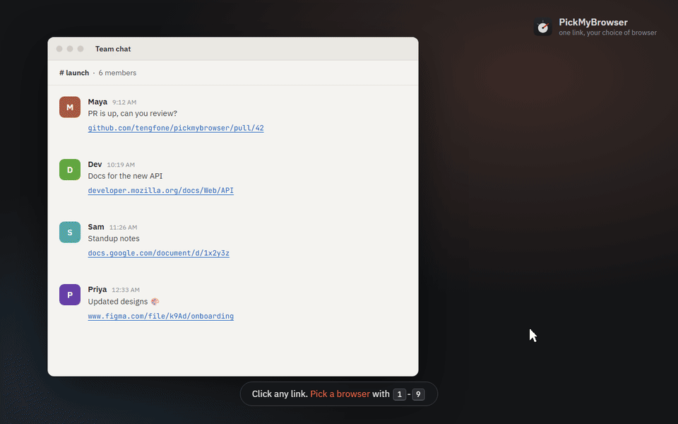

# PickMyBrowser

Pick which browser opens every link. Set PickMyBrowser as your default browser and each link you click opens a small picker: press a number, done.



Windows, macOS and Linux. Small (≈4 MB app, ≈1.6 MB Windows installer), sits in the tray, and only runs when you start it or click a link.

## Features

- **Pick with one key:** `1`–`9` opens that browser, `↑`/`↓` + `Enter`, or click.
- **Private windows:** hold `Shift` while picking.
- **Profiles:** `→` lists a browser's profiles (Chrome, Edge, Brave, Firefox…), then press its letter.
- **Rules:** send `*.figma.com` or `github.com/work/*` straight to a browser/profile after a short countdown (`Space` to cancel, or set it to open instantly).
- **Safer links:** strips tracking parameters (`utm_*`, `fbclid`, …) and warns about lookalike domains such as `paypa1.com`. Lookalikes never auto-open.
- **Recent links**, type-to-filter when you have more than 9 browsers, light/dark themes, picker at the cursor or centred.
- Real browser icons, detected automatically.

## Install

Download from [Releases](https://github.com/tengfone/pickmybrowser/releases/latest):

| Platform | File |
| --- | --- |
| Windows | `PickMyBrowser-Setup-x.y.z.exe` (per-user, no admin) |
| macOS Apple Silicon / Intel | `PickMyBrowser-x.y.z-mac-arm64.zip` / `-mac-x64.zip` → move to Applications |
| Debian / Ubuntu | `PickMyBrowser-x.y.z-amd64.deb` |
| Fedora / openSUSE | `PickMyBrowser-x.y.z-x86_64.rpm` |
| Other Linux (advanced) | `PickMyBrowser-x.y.z.AppImage` |

Builds are unsigned. macOS: right-click the app → Open the first time. Windows: SmartScreen → More info → Run anyway.

Then open PickMyBrowser and press **Set as default** (or choose it in your system's default-browser settings).

## Uninstall

Nothing is left behind: settings, cached icons, launch-at-login entries and the browser registration are all removed.

- **Windows:** Settings → Apps → PickMyBrowser → Uninstall.
- **macOS:** PickMyBrowser Settings → General → **Remove PickMyBrowser**, then drag the app to the Bin.
- **Linux:** `sudo apt remove pickmybrowser` / `sudo dnf remove pickmybrowser`.

## Development

Needs Node (see `.nvmrc`) and Rust (see `src-tauri/rust-toolchain.toml`); on Linux also the [Tauri system packages](https://tauri.app/start/prerequisites/).

```sh
npm ci
npm run tauri dev          # run
npm run tauri build        # installers in src-tauri/target/release/bundle
npm run test:e2e           # build the E2E app and run the WebdriverIO suite
npm run test:smoke         # release-binary smoke test (after `npx tauri build --no-bundle`)
npm run demo               # re-record assets/demo.gif (needs ffmpeg + Edge/Chrome; after build:e2e)
```

The E2E build (`--features wdio`, `PMB_E2E=1`) uses a throwaway config folder and a fixed browser list, and records launches instead of opening browsers, so it never touches your real setup.

Releasing: `npm run release:patch|minor|major` bumps the version, tags and pushes; CI tests on all three OSes, builds every platform and creates a draft release.
